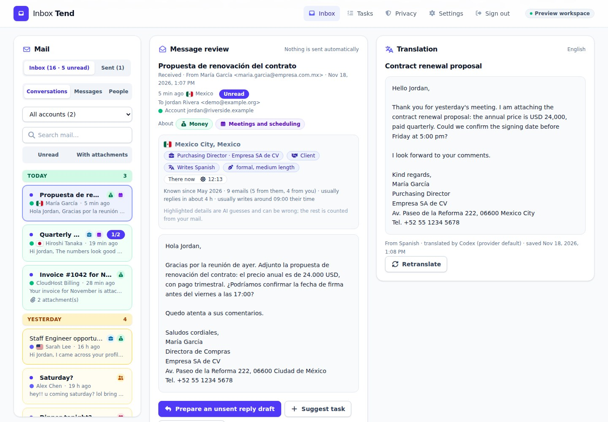
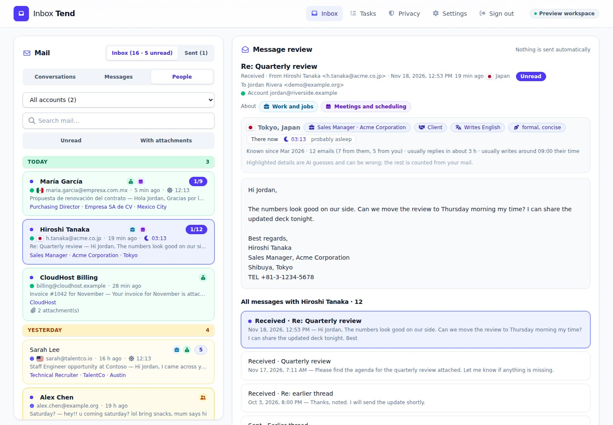
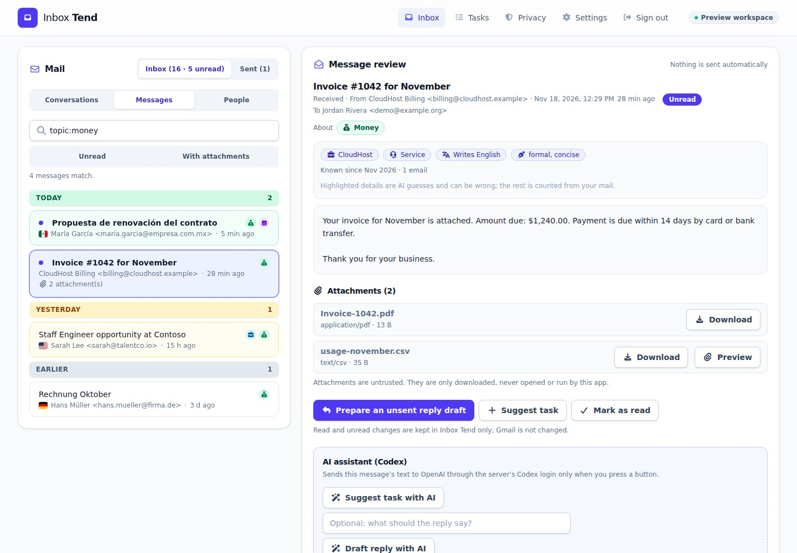
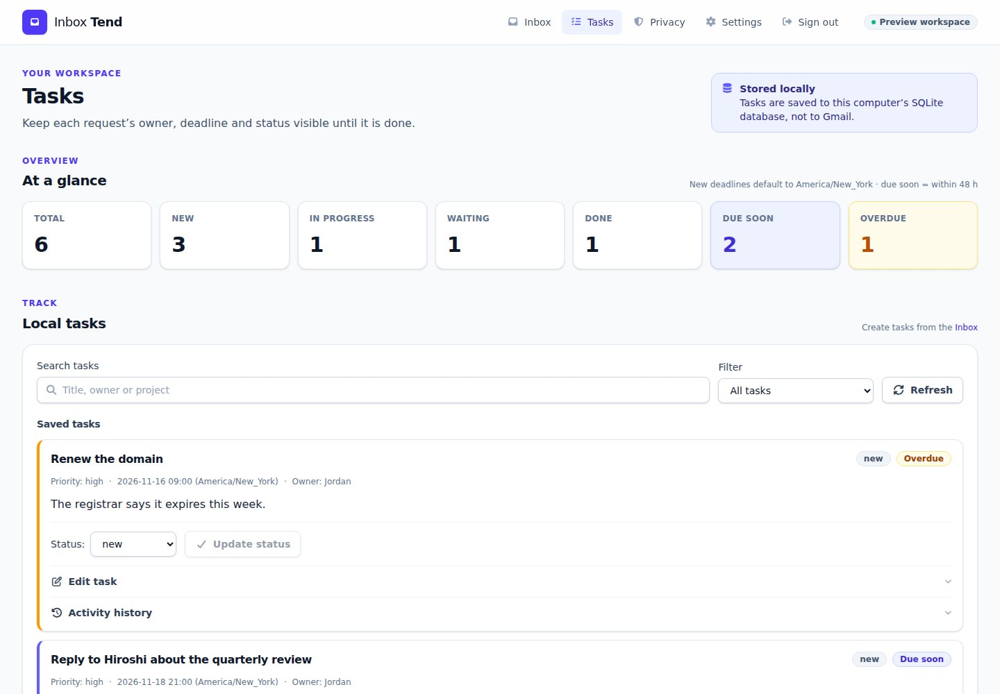
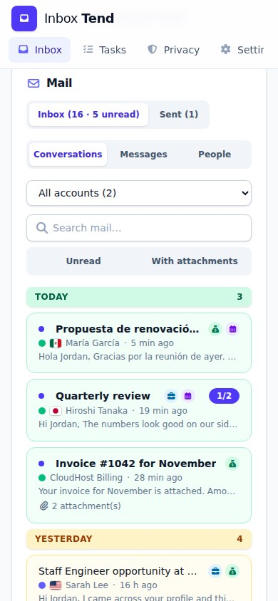

# Inbox Tend

**Self-hosted Gmail workspace · SQLite · AGPL-3.0**

Inbox Tend copies your Gmail into a SQLite database on your own server, shows who each message is from and what it is about, translates it, and helps you turn the next step into a tracked task. No email is ever sent, deleted or trashed.



*Screenshots use fictional demo data (`make demo`).*

## Features

- **Several Gmail accounts.** Connect as many as you like (Settings → Gmail accounts). Their mail is stored and searched together, the Inbox can be narrowed to one account, and each account has its own read-only or read/unread access and can be removed on its own.

  
- **Local copy of your mail.** Inbox and sent mail with full headers, text and HTML bodies, labels and attachments, saved in SQLite. Browsing never calls Gmail; **Refresh inbox** fetches only what is new. Gmail access is read-only unless you opt in (Settings → Gmail access) to marking mail read or unread in Gmail.
- **Mark all as read.** One button in the Inbox marks every unread message in the current list as read (search, filters and the account choice count). It is always saved in Inbox Tend, and also in Gmail, in one batch request per account, for accounts that allow changing read/unread.
- **Sign in with Google** (optional). Besides the password, people can sign in with a Google account that is linked to their user (Settings → Account). Nobody is registered this way, and the Gmail reading permission is a separate grant. See [docs/gmail-web.md](docs/gmail-web.md).
- **Search like Gmail**, locally and instantly: words, `from:`, `to:`, `subject:"…"`, `is:unread`, `has:attachment`, `topic:money`.
- **Three views:** conversations, single messages, or people (one row per correspondent). Rows are grouped Today, Yesterday and Earlier, with unread in bold and how long ago each message arrived.
- **Sender details** (opt-in, AI guess once per sender, saved):

  

  country flag, city, company and role, language, relationship, writing style, their local time now, and your history together. Never gender, age or similar.
- **Topic icons** (opt-in): up to two of 17 topics per message (money, job, love, friends and family, travel, shopping, meetings, security, health, legal, education, tech, social, news, events, food, promotions). One AI request per 20 messages, saved. Press a topic to list everything about it.

  
- **Translation** (opt-in): the opened message in your language in a third column, saved so it is translated once.
- **Tasks:** review a suggested task, edit it, save it with owner, priority, deadline and status, with an audit history. Reply drafts are prepared for you and never sent.

  
- **AI assistant** (opt-in): drives Codex CLI (default) or Claude Code CLI installed on the server. Provider, model and timeout are set in Settings. Task suggestions quote and verify their evidence. Each feature sends only what [docs/ai-assistant.md](docs/ai-assistant.md) lists.
- **Responsive:** works on a phone.

  

Without the AI switches, suggestions are plain rules (subject becomes title, snippet the description) and nothing leaves your server.

## Try it in a minute, no Gmail needed

```sh
make demo        # fictional data on http://127.0.0.1:8781
```

Sign in as `demo@example.org` / `demo-password-123`. The demo never calls an AI. To retake the screenshots, see `scripts/screenshots.mjs`.

**Your data lives on your server.** The database holds your correspondence in plain form (only the Gmail refresh token is encrypted), so run Inbox Tend on a private machine behind HTTPS and the built-in login, keep `data/` and `.env` private (mode 700/600, both git-ignored), and use disk encryption and encrypted backups. Removing a Gmail account deletes its stored messages and attachments. Message bodies and attachments are untrusted: they are shown as plain text only, HTML is never rendered, and attachments are downloaded as opaque files, never opened or executed. Per-user preferences (timezone, due-soon window, default priority, sync of sent mail, messages per folder, attachment size limit, password change) are on the **Settings** page and stored in the `user_settings` table; they override the `.env` values below. Tunables (`.env`): `INBOX_TEND_SYNC_QUERY` (default `in:inbox`), `INBOX_TEND_SYNC_SENT_QUERY` (default `in:sent`), `INBOX_TEND_SYNC_MAX_MESSAGES` (default 200 per folder), `INBOX_TEND_ATTACHMENT_MAX_BYTES` (default 10 MiB).

## Current architecture

- `app.py`: loopback-only standard-library HTTP server and authenticated Gmail routes. Task creation reads the message from the local database instead of trusting client-supplied content. Writes require a per-session CSRF token, loopback Host, same-origin request, JSON content type and a 16 KiB body limit.
- `tasks.py`: SQLite tasks, migration from the initial branch schema, source-ID deduplication, optimistic revision conflicts, audit events and Saipan deadline states.
- `static/`: responsive browser pages styled with Tailwind CSS (compiled ahead of time and committed; the app itself needs no Node) and Font Awesome Free icons (self-hosted), see [docs/frontend.md](docs/frontend.md); (Home, Inbox, Tasks, Privacy) sharing one header, footer and `common.js`. The visual hierarchy draws on the local `statistics.diy` project while keeping Inbox Tend's own HTML/CSS and no frontend build dependency. Dynamic content uses text nodes.
- `gmail_web.py` and `connectors/gmail_readonly.py`: session-bound Web OAuth and read-only Gmail inbox panel, documented in [docs/gmail-web.md](docs/gmail-web.md). `gmail_oauth_local.py` remains a separate one-shot Desktop prototype.
- `tests/`: local HTTP, persistence, migration, validation and connector tests.

## Security boundary

The app has public `/`, `/login` and `/privacy` pages, with `/user/inbox`, `/user/tasks`, `/user/settings` and all mailbox/task APIs behind a single-admin session. Initial admin credentials are configured by `.env` and bootstrapped into the SQLite `users` table once; only a password hash is stored in the database. Sign in with Google (when configured) accepts only linked Google accounts or a verified email equal to a username. Sessions use HttpOnly cookies, a per-session CSRF token and a 12-hour expiry. Bind remains `127.0.0.1`; Caddy provides HTTPS while application login protects private routes. The Inbox shows the signed-in user's mail from the local SQLite copy. This is a single-admin service. There is no send, delete-mail, agent execution or model API endpoint. `DELETE /api/tasks/{id}` is an explicit retention control and permanently removes that task and its audit entries.

For the internal subdomain's current setup and remaining gates, see [docs/deployment-internal.md](docs/deployment-internal.md). [docs/real-app-roadmap.md](docs/real-app-roadmap.md) sets out the next implementation stages. [PLAN.md](PLAN.md) tracks future work.

## License

[GNU Affero General Public License v3.0 or later](LICENSE) (AGPL-3.0-or-later). Copyright 2026 Scyllarus LLC.

You may use, study, change and share Inbox Tend, including running it for others as a hosted service. If you let other people use a modified version over a network, the AGPL requires you to offer them the source code of your version under the same license. The footer of every page links to the source for that reason; keep that link (pointing at your own source if you modified the app). The fonts, icons and CSS tooling bundled under `static/vendor/` keep their own licenses (see `THIRD_PARTY_LICENSES.md`), all compatible with the AGPL.
