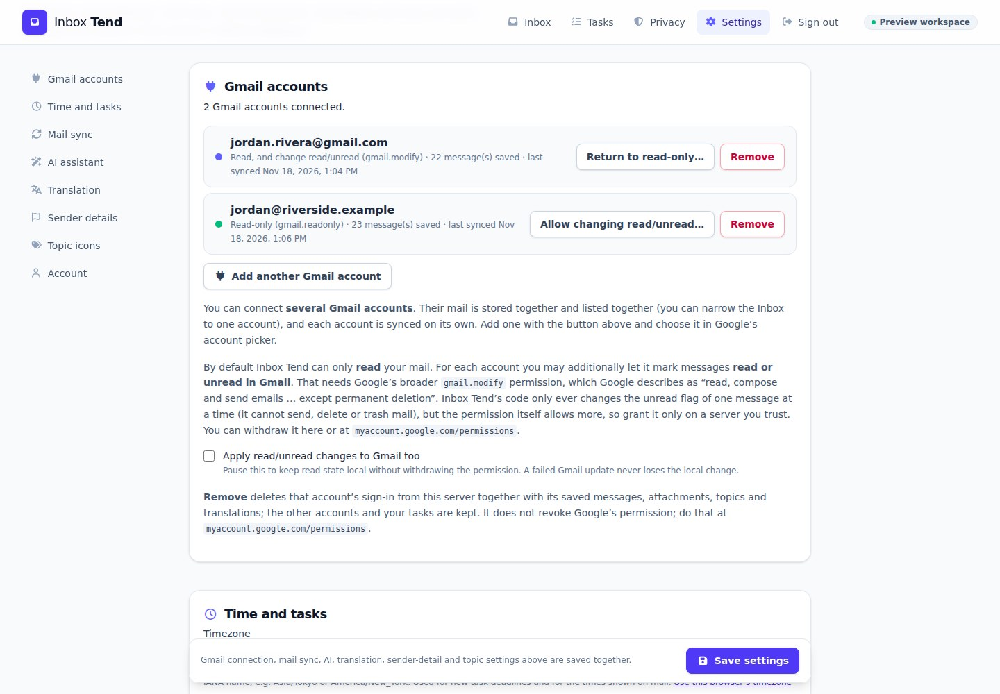

# Inbox Tend

**Self-hosted Gmail and IMAP workspace · SQLite · AGPL-3.0**

Inbox Tend copies Gmail and IMAP mail, including iCloud Mail, into SQLite on your server. It helps you review messages, translate text, and turn follow-up into tracked tasks. It never sends, deletes or trashes mail from a provider.


*Screenshots use fictional demo data (`make demo`).*

## Quick start

Copy `.env.example` to `.env`, configure an administrator and keep that file private; [QUICKSTART.md](QUICKSTART.md) has the setup steps. Then run:

```sh
make dev
```

Open `http://127.0.0.1:8765`. One FastAPI server serves the pages, API and static files. Python edits restart the development server; page and script edits show a refresh prompt so reading is not interrupted, while compiled CSS updates without a page reload. `make dev` stops an earlier Inbox Tend process on that port before starting and refuses to stop unrelated programs. The default workflow does not need a separate frontend server. Next.js remains available for comparison with `make dev-next`; editing Tailwind source styles still requires `make css`.

## Features

- **Several Gmail accounts.** Connect as many as you like (Settings → Gmail accounts). Their mail is stored and searched together, the Inbox can be narrowed to one account, and each account has its own read-only or read/unread access and can be removed on its own.

- **IMAP accounts, including iCloud Mail.** Connect an IMAP mailbox with its server address and app password. Imported mail joins the same local Inbox; read/unread changes update the IMAP server. There is no SMTP sending. See [IMAP mail](#imap-mail-including-icloud-mail).

  
- **Local copy of your mail.** Inbox and sent mail with full headers, text and HTML bodies, labels and attachments, saved in SQLite. Browsing never calls Gmail; new mail is fetched automatically (every 5 minutes by default; change or turn off under Settings → Mail sync) or on **Refresh inbox**. Gmail access is read-only unless you opt in (Settings → Gmail access) to marking mail read or unread in Gmail.
- **Charts at the top of the Inbox.** Unread and weekly totals, mail received and sent per day (30 days), who writes most, and (with topic icons on) what the mail is about, drawn with Chart.js (bundled, no CDN) from your SQLite copy, following the account filter. Hover for numbers; press a day, a sender or a topic to see that mail (`on:2026-11-17`, `from:`, `topic:`).
- **Mark all as read.** One button in the Inbox marks every unread message in the current list as read (search, filters and the account choice count). It is always saved in Inbox Tend, and also in Gmail, in one batch request per account, for accounts that allow changing read/unread.
- **Sign in with Google** (optional). Besides the password, people can sign in with a Google account that is linked to their user (Settings → Account). Nobody is registered this way, and the Gmail reading permission is a separate grant. See [docs/gmail-web.md](docs/gmail-web.md).
- **Search like Gmail**, locally and instantly: words, `from:`, `to:`, `subject:"…"`, `is:unread`, `has:attachment`, `topic:money`, `on:2026-11-17` (one day).
- **Three views:** people (the default, one row per correspondent), conversations, or single messages. Rows are grouped Today, Yesterday and Earlier, with unread in bold and how long ago each message arrived.
- **Unread People view:** read rows wait before dismissing, then fade and smoothly close so the remaining list moves gradually. Choose the waiting time under Settings → Time and tasks; the Unread filter preference stays in the browser.
- **Sender details** (opt-in, AI guess once per sender, saved):

  

  country flag, city, company and role, language, relationship, writing style, their local time now, and your history together. Never gender, age or similar.
- **Topic icons** (opt-in): up to two of 17 topics per message (money, job, love, friends and family, travel, shopping, meetings, security, health, legal, education, tech, social, news, events, food, promotions). One AI request per 20 messages, saved. Press a topic to list everything about it.
- **Message websites** (opt-in): AI preselects a likely official website from domains already in each saved message or its sender address. The Message review link opens in a new tab, is labelled as a guess, and stays hidden when there is no plausible candidate. Guesses are cached in SQLite.

  
- **Offline translation** (opt-in): Argos language packs translate the opened message on your server. The result appears beside the original and is saved in SQLite; translation does not call an AI provider. To keep local translation responsive, only the first 5,000 characters of a long message are translated; the original remains available. Install only the language directions you need (see below).
- **Tasks:** review a suggested task, edit it, save it with owner, priority, deadline and status, with an audit history. Creating a task copies the selected scope's saved mail and attachments; image copies support translation and interpretation on the Tasks page after you press the AI button. Reply drafts are prepared for you and never sent.
- **Inbox view controls task scope.** Create a task in People view to copy that person's saved mail and attachments, in Conversations view to copy that thread, or in Messages view to copy only the open message. The selected account filter also limits People scope. Each task keeps a database snapshot of its source mail and all locally stored attachments; image copies remain available in the task's Images section.
- **Website project skill:** from a task's **Task project** section, enter a repository name and use `skill-website-createor` to build a local website with the Inbox Tend stack. Review its path, file list and README before the separate action that publishes a private GitHub repository. Requires the skill at `~/skill-website-createor`, Codex CLI, and GitHub CLI authentication for publishing.
- **AgentSteers mock handoff (opt-in, disabled by default):** reviewed tasks can be sent from either the task list or expanded task details to a separately configured mock-only MCP service, with explicit confirmation and status display. No real Codex, GitHub write, or email send is performed. A fictional registration-page task is included in `make demo`. [Setup and limitations](docs/agentsteers-handoff.md).

  
- **AI assistant** (opt-in): drives Codex CLI (default) or Claude Code CLI installed on the server. Provider, model and timeout are set in Settings. Text task suggestions quote and verify their evidence. Inbox suggestion buttons copy image attachments into a task; an explicit action on the Tasks page translates and explains those images in Chinese and can update the task wording after review. Each feature sends only what [docs/ai-assistant.md](docs/ai-assistant.md) lists.
- **Responsive:** works on a phone.

  

Without the AI switches, suggestions are plain rules (subject becomes title, snippet the description) and nothing leaves your server.

## Offline translation setup

Run `make dev`: it creates `.venv`, installs `requirements.txt`, and on Debian/Ubuntu installs the matching `pythonX.Y-venv` package if `ensurepip` is missing. The first run needs network access and may ask for `sudo`. Later runs reuse the environment unless requirements change. Then use **Settings → Translation → Local language packs** to download only the directions you need. The page shows installed packs and download status.

```sh
make dev
```

If automatic setup cannot reach the package repositories, install the Python dependencies manually and retry `make dev`; until then, Settings reports that the local translation engine is unavailable. You can also install language directions from the command line; for example, English mail into Chinese and Spanish mail into English:

```sh
.venv/bin/python scripts/install_translation_packs.py en_zh es_en
```

Each direction is a separate package. The current Argos package directory lists English → Chinese at about 67 MB and Spanish → English at about 64 MB compressed; installed size and RAM use are higher. Packages are downloaded when you request them in Settings or with the command above, not when a message opens. Keep the packages on the server across deploys; by default Argos uses its own user data directory, or set `ARGOS_PACKAGES_DIR` to a persistent path. Then choose an installed target language under **Settings → Translation** and save your settings. Choose 1,000, 3,000, or 5,000 characters per new translation there; shorter input usually finishes sooner. Optionally enable **Pretranslate unread inbox messages when the server is idle**: a background worker starts one locally stored, untranslated unread message per pass when CPU load is low, and saves it to the same SQLite cache. It is off by default, uses the selected translation length and installed packs, and never fetches mail or sends it to an API. The Settings page shows its count and the latest foreground translation's mail, queue, and model times until the server restarts. Cached translations remain readable; use **Retranslate** to apply a new length to an old result. Missing source-to-target routes return a clear error. Old AI translations remain readable until retranslated. See [Argos language packages](https://data.argosopentech.com/argospm/v1/) and [Argos settings](https://github.com/argosopentech/argos-translate/blob/master/docs/source/settings.rst).

If Settings shows **“The running server does not have the language-pack API yet”**, the browser has loaded a newer settings page than the running Python process. Deploy the matching `app.py` and `local_translation.py`, install `requirements.txt`, and restart Inbox Tend. Refresh the Settings page afterward.

## Try it in a minute, no Gmail needed

```sh
make demo        # fictional data on http://127.0.0.1:8781
```

Sign in as `demo@example.org` / `demo-password-123`. The demo never calls an AI. To retake the screenshots, see `scripts/screenshots.mjs`.

**Your data lives on your server.** The database holds your correspondence in plain form (only the Gmail refresh token is encrypted), so run Inbox Tend on a private machine behind HTTPS and the built-in login, keep `data/` and `.env` private (mode 700/600, both git-ignored), and use disk encryption and encrypted backups. Removing a Gmail account deletes its stored messages and attachments. Message bodies and attachments are untrusted: HTML mail is never rendered, text attachments are previewed as plain text, and PNG/JPEG/GIF/WebP attachments up to 2 MiB can be shown as images after signature checks. Other attachments are downloaded as opaque files. Per-user preferences (timezone, due-soon window, default priority, sync of sent mail, messages per folder, attachment size limit, password change) are on the **Settings** page and stored in the `user_settings` table; they override the `.env` values below. Tunables (`.env`): `INBOX_TEND_SYNC_QUERY` (default `in:inbox`), `INBOX_TEND_SYNC_SENT_QUERY` (default `in:sent`), `INBOX_TEND_SYNC_MAX_MESSAGES` (default 200 per folder), `INBOX_TEND_ATTACHMENT_MAX_BYTES` (default 10 MiB).

## Current architecture

- `asgi.py`, `task_api.py` and `app.py`: FastAPI/Uvicorn entry point, native task-read routes, and the remaining authenticated routes behind an ASGI adapter during migration. Writes still require a per-session CSRF token, loopback Host, same-origin request, JSON content type and a 16 KiB body limit.
- `tasks.py` and `db_models.py`: SQLModel engine and task mappings on the existing SQLite file. Existing SQL queries and migrations remain in `tasks.py` during the data-layer migration.
- `cli.py`: Typer commands for serving the API and backing up SQLite.
- `frontend/`: optional Next.js App Router page shell for comparison. The default development workflow serves the existing pages directly from FastAPI.

- `static/`: page markup and browser scripts served directly by FastAPI, with small Stimulus controllers for shared interactions, compiled Tailwind CSS and self-hosted Font Awesome; see [docs/frontend.md](docs/frontend.md). Next.js requires Node.js when used.
- `gmail_web.py` and `connectors/gmail_readonly.py`: session-bound Web OAuth and read-only Gmail inbox panel, documented in [docs/gmail-web.md](docs/gmail-web.md). `gmail_oauth_local.py` remains a separate one-shot Desktop prototype.
- `tests/`: local HTTP, persistence, migration, validation and connector tests.

Run `make dev`, then open `http://127.0.0.1:8765`. One FastAPI server provides pages, API and static files; Python changes restart the server, compiled CSS changes update without a page reload, and other page changes offer a manual refresh. Next.js remains available with `make dev-next` for comparison. Existing SQLite data is used in place; no export or import is needed.

## Security boundary

The app has public `/`, `/login` and `/privacy` pages, with `/user/inbox`, `/user/tasks`, `/user/settings` and all mailbox/task APIs behind a single-admin session. Initial admin credentials are configured by `.env` and bootstrapped into the SQLite `users` table once; only a password hash is stored in the database. Sign in with Google (when configured) accepts only linked Google accounts or a verified email equal to a username. Sessions use HttpOnly cookies, a per-session CSRF token and a 12-hour expiry. Bind remains `127.0.0.1`; Caddy provides HTTPS while application login protects private routes. The Inbox shows the signed-in user's mail from the local SQLite copy. This is a single-admin service. Mail sending and deletion remain unavailable. A task's website build explicitly runs Codex in a separate local directory; GitHub publishing requires another explicit click and always creates a private repository. `DELETE /api/tasks/{id}` is an explicit retention control and permanently removes that task and its audit entries.

On a task page, **Create as project** writes `task.json`, `emails.json`, `manifest.json`, saved attachment files and `attachments.zip` to `.tasks/<task-id>` in the project directory on the server (for example `/root/github/inboxtend/.tasks/2`). Set `INBOX_TEND_TASKS_DIR` to change the parent directory; the server process needs write access to it. **Download all attachments** refreshes that project and downloads its ZIP. **Preview all attachments** shows verified small raster images and text files, with downloads for other stored files. Only attachments already stored in the local mail cache can be included; unavailable files are listed in `manifest.json`. The `.tasks/` directory is ignored by Git.

For the internal subdomain's current setup and remaining gates, see [docs/deployment-internal.md](docs/deployment-internal.md). [docs/real-app-roadmap.md](docs/real-app-roadmap.md) sets out the next implementation stages. [PLAN.md](PLAN.md) tracks future work.

## License

[GNU Affero General Public License v3.0 or later](LICENSE) (AGPL-3.0-or-later). Copyright 2026 Scyllarus LLC.

You may use, study, change and share Inbox Tend, including running it for others as a hosted service. If you let other people use a modified version over a network, the AGPL requires you to offer them the source code of your version under the same license. The footer of every page links to the source for that reason; keep that link (pointing at your own source if you modified the app). The fonts, icons and CSS tooling bundled under `static/vendor/` keep their own licenses (see `THIRD_PARTY_LICENSES.md`), all compatible with the AGPL.

## IMAP mail (including iCloud Mail)

In **Settings → IMAP accounts**, enter your address, server, username and password. For iCloud Mail use `imap.mail.me.com` on TLS port 993 and an [Apple app-specific password](https://support.apple.com/en-us/102654). The username is normally the part before `@`; try the full address if Apple rejects it. Set `INBOX_TEND_TOKEN_KEY` in `.env` before connecting: Inbox Tend encrypts the IMAP password with the same key used for Gmail refresh tokens. Keep that key stable across restarts.

IMAP sync reads the inbox and, when the server marks one, the sent folder. It stores headers, bodies and size-limited attachments in the same local SQLite cache as Gmail. Search, translation and task creation work on the imported mail. Read/unread changes update the IMAP `\\Seen` flag, including **Mark all as read**; if the server update fails, the local change is kept and an error is shown. The connector never sends or deletes mail. The first sync reads up to the configured message limit per folder; later syncs refresh that window. IMAP server settings are currently limited to TLS port 993.
